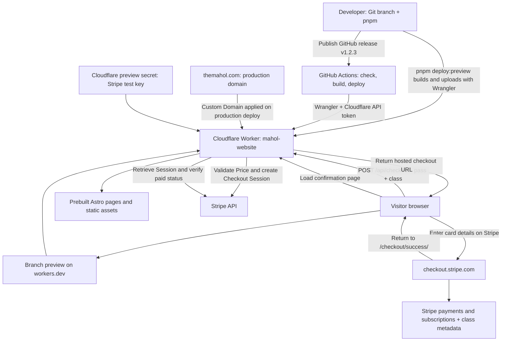

# Architecture

## How the app works

Astro builds the public pages into HTML, CSS, images, and browser JavaScript. Cloudflare serves these static assets, while a **Worker** (server code running on Cloudflare) handles checkout requests and payment confirmation. Stripe stores payment and subscription records; this app has no database or attendance tracking.

A drop-in uses a one-time payment; the other four passes create recurring subscriptions. The server checks the configured CAD price and required class selection, then saves `mahol_pass`, `class`, and `class_name` on the Checkout Session and its PaymentIntent or Subscription. The success page confirms a completed, paid Session directly with Stripe. Card details stay on Stripe's hosted page; no webhook endpoint is currently used.

## Deployment and domains

The Worker is named `mahol-website`. The current [branch preview](https://codex-astro-preview-mahol-website.birdy.workers.dev/classes/) runs on `workers.dev`, Cloudflare's hosted domain. `wrangler.jsonc` declares `themahol.com` as a production Custom Domain, applied when production is deployed. Before the first release, confirm the zone is active in the deployment account, configure the live Stripe secret, and remove any conflicting CNAME or old Pages domain association at cutover. No production deployment or DNS cutover has been performed by adding this configuration. See the [release instructions](../README.md#release-a-version).

`pnpm deploy:preview` builds and publishes the current branch manually. GitHub
Actions also provides **Deploy preview**, triggered only by **Run workflow** with
a branch selected; `.github/workflows/deploy_preview.yml` checks and deploys it.
Production releases are manual: publish a stable GitHub release with a version
tag such as `v1.2.3` to run `.github/workflows/deploy.yml`. It validates the version,
checks, builds, and deploys the tagged commit,
and GitHub's `production` environment records the deployment status and history.
Drafts, prereleases, tag pushes, and pushes to `main` do not deploy production.
See the [release instructions](../README.md#release-a-version).
Top-level `vars` in `wrangler.jsonc` define the five live Price IDs and `STRIPE_MODE=live` for production, which rejects test keys. Preview settings use test Price IDs and `STRIPE_MODE=test`, which rejects live keys. API keys stay in Cloudflare secrets, including the shared Preview Base test key for new previews. Existing previews need separate secret updates. Local `.env` uses `STRIPE_MODE=test`. `pnpm deploy:production` is also available to deploy production manually.

## Technology

| Tool                  | What it does here                                                                                                                                                                |
| --------------------- | -------------------------------------------------------------------------------------------------------------------------------------------------------------------------------- |
| pnpm                  | Installs packages, runs project commands, and manages the pinned local Node.js version. `pnpm-lock.yaml` records the resolved dependencies.                                      |
| Node.js               | Runs local tools and tests. Deployed server code runs in Cloudflare's Workers runtime.                                                                                           |
| Astro + TypeScript    | Builds pages and server routes. TypeScript checks data shapes before deployment.                                                                                                 |
| Tailwind CSS          | Styles pages with utility classes such as `p-5`; prefer its default tokens.                                                                                                      |
| Git + GitHub          | Git records changes as commits and separates work into branches. GitHub hosts the repository for sharing and review. A push uploads commits; it does not merge them into `main`. |
| Wrangler + Stripe CLI | Project-local command-line tools for Cloudflare deployment and Stripe inspection. Use them through `pnpm exec`. Their logins are separate from app API keys.                     |
| Oxlint + Oxfmt        | Catch code issues and format files. Run `pnpm check` before sharing changes.                                                                                                     |

## Where to start

Start with the [README](../README.md) to run the site and [debugging guide](debug.md) when something fails. Page content is in `src/pages/`, shared UI in `src/components/`, and styling in `src/styles.css`. Pass names, prices, and billing intervals are defined once in `src/data/dance_passes.ts`. The checkout flow connects `src/scripts/dance_passes.ts`, `src/pages/api/checkout.ts`, `src/lib/checkout.ts`, and `src/pages/checkout/success.astro`; `tests/checkout.test.mjs` covers its validation rules.

Before changing a flow, ask: does this belong in the browser or on the server, which Stripe account/mode owns these Prices, and is the change for a branch preview or production? Keep API keys out of browser code and Git. Billing changes need agreement on both the Stripe Price and the app's expected amount/interval.
